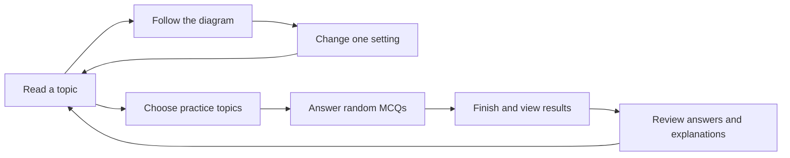
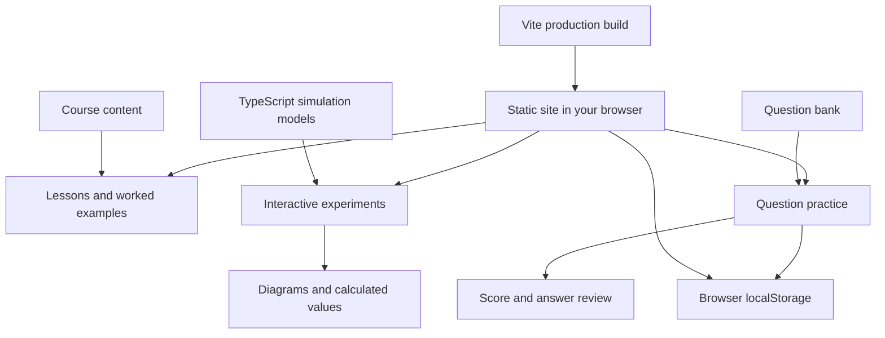

# SOC3050 Visual Lab

A beginner-friendly study site for embedded systems on STM32 / ARM. Twenty lessons connect plain-language explanations, worked examples, animated diagrams, and interactive experiments. Multiple-choice practice supports topic filters, randomized runs, and answer review.

Built with **React, TypeScript, and Vite**. No backend or account required. Practice attempts, study progress, and the final-project workspace save in your browser.

## How learning works

Read a topic, trace its diagram, and change an experiment setting to see the effect. When ready, choose topics for a practice run; the default is 33 random questions. Finished runs show results and explanations, with links back to lessons.



## How the site fits together

The site runs in your browser. Lesson data supplies the reading and questions; simulation models calculate the values shown in experiments. Saved progress stays on your device.



## Quick start

Requires **Node.js 22 or newer**, including npm. If you use nvm, run `nvm install` and `nvm use` in this directory.

### Linux / macOS

```bash
./start.sh
```

The script installs dependencies with `npm ci` when needed, then starts the development server. Open the URL printed by Vite, normally **http://localhost:5173**. Stop with `Ctrl+C`.

Pass Vite options through the script:

```bash
./start.sh --port 5174
```

### Windows

From PowerShell:

```powershell
.\start.bat
```

From Command Prompt, run `start.bat`. It checks Node/npm, installs dependencies when needed, and starts the same development server. You can also double-click the file. Pass options with `start.bat --port 5174`.

### Any platform

```bash
npm ci
npm start
```

Run `npm ci` again after dependency changes. The lockfile is included for reproducible installs. Installing dependencies requires internet access.

## Commands

| Command | Purpose |
| --- | --- |
| `npm start` / `npm run dev` | Start the development server |
| `npm run build` | Type-check and build the site into `dist/` |
| `npm run preview` | Serve the production build locally |
| `npm test` | Run unit tests |
| `npm run test:browser` | Run browser checks with Playwright |

Install Chromium before running browser checks:

```bash
npx playwright install chromium
npm run build
npm run test:browser
```

On Linux machines missing browser system libraries, use `npx playwright install --with-deps chromium`. Browser checks start their own production preview on port 4173. Stop any server using that port first, or set `PLAYWRIGHT_PORT` to an unused port. Reports and screenshots are written to ignored local directories.

## Project layout

```text
src/
  components/       Learning interface and shared diagrams
  course/           Lessons, practice questions, notes, and source manifest
  labs/             Interactive experiments
  models/           Simulation and hardware teaching rules
public/
  fonts/            Local fonts and license notices
  registers/        Generated register illustrations
  source/           Pinned original course text and code
scripts/            Register-illustration generation tools
tests/
  unit/             TypeScript unit tests (Vitest)
  browser/          Browser interaction checks (Playwright)
  fixtures/         Shared source fixtures
start.sh            Linux/macOS development launcher
start.bat           Windows development launcher
```

Generated builds, dependencies, environment files, local audit records, and temporary reference material are excluded by `.gitignore`. Keep `package-lock.json`, source assets, and test fixtures in Git.

## Production hosting

```bash
npm ci
npm run build
```

Publish the contents of `dist/` to a static host. The current asset URLs expect hosting at the domain root, such as `https://example.com/`. Hash routes such as `/#lesson/06` do not require server-side route rewrites. Hosting under a subdirectory needs corresponding Vite base and asset-URL changes.

```bash
npm run preview
```

Preview serves the built files locally; it is not a production server. No environment variables or API keys are needed. External reference links require internet access.

## Course sources and attribution

Based on the [published SOC3050 course](https://gnoejh.github.io/soc3050code/), pinned to source revision `c84fa2b24002f484a37a8b946b5720109d380e25`. This site uses the `projects2026_arm` course; archived AVR material and the separate Python course are excluded.

Original course snapshots and their notices remain in `public/source/`. Provenance and the preserved-file inventory are recorded in `src/course/manifest.json` and `public/source/inventory.json`. Font license notices are included in `public/fonts/`.

Learning pages use rewritten topic explanations. Original lectures and slides are external references outside the main learning flow. Hardware timing is stretched for teaching; browser physics and response plots are simulations, not measurements from a physical board.

Register illustrations are already generated. After changing the corresponding source definitions, regenerate them with:

```bash
python3 scripts/render-registers.py
```

Python is not required for normal development or production builds.

## Contributing

See [CONTRIBUTING.md](CONTRIBUTING.md) for setup, teaching standards, test locations, and pull request guidance.

## License and authorship

Original Visual Lab work is copyright © 2026 [S0ME2](https://github.com/S0ME2), licensed under [Zlib](LICENSE). Reuse is allowed; falsely claiming original authorship is prohibited. Changed versions must be marked, and the license notice must remain in source distributions.

Third-party course material, renderer code, fonts, and dependencies keep their own applicable terms. See [THIRD_PARTY_NOTICES.md](THIRD_PARTY_NOTICES.md) for attribution and license scope.

## Publishing the repository

The local repository uses the `main` branch. Add your remote when ready:

```bash
git remote add origin <your-repository-url>
```

Review the files, then create your first commit yourself. After that:

```bash
git push -u origin main
```

No repository URL, credentials, or remote are preconfigured.
